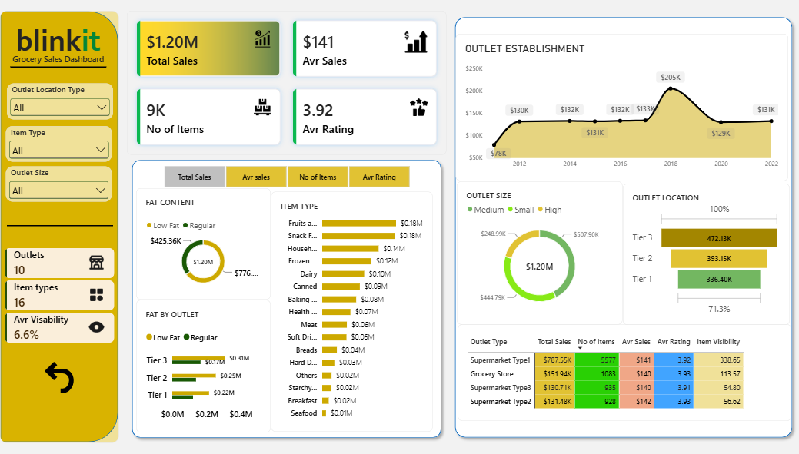

# Blinkit Grocery Sales Dashboard (Power BI)

## What this project does

This is a one-page interactive Power BI dashboard built on 8,523 sales records from 10 Blinkit outlets. It shows total sales, average sales, number of items and average rating, and lets you break sales down by outlet type, outlet size, location tier, establishment year, product category and fat content.

> I built the dashboard by following a Power BI tutorial on YouTube. The findings section is my own interpretation of the results.



## Why it is useful

A grocery manager can use the dashboard to see quickly which outlets and product categories bring the most revenue, and filter by location, outlet size or item type to compare them. Main findings:

- Average sales per item is almost the same everywhere (~$140–142), so outlets with higher revenue mainly sell **more items**, not better-selling items.
- Supermarket Type1 brings 65.5% of sales, and Tier 3 cities are the biggest market (39%).
- Fruits & Vegetables and Snack Foods together make up about 29% of sales.
- Low Fat products make up 64.6% of sales in every location tier.

## How I processed the data

**1. Loading**
- Imported `BlinkIT_Grocery_Data.xlsx` (8,523 rows, 12 columns) into Power BI with Power Query.

**2. Cleaning (Power Query)**
- The `Item Fat Content` column had inconsistent labels (`LF`, `low fat`, `reg`). I replaced them so there are only two values: **Low Fat** and **Regular**.
- Checked column data types (text, whole number, decimal).

**3. DAX measures**
- `Total Sales`, `Avr Sales`, `No of Items`, `Avr Rating`, `Outlet count`, `Item types`, `Avr Visability`.

**4. Report building**
- KPI cards for the main measures.
- Charts: sales by fat content (donut), item type (bar), fat content by location tier (clustered bar), outlet establishment year (line), outlet size (donut), outlet location (funnel), and a matrix comparing outlet types.
- Slicers for Outlet Location Type, Outlet Size and Item Type.
- A field-parameter slicer to switch the chart metric (Total Sales, Avg Sales, No. of Items, Avg Rating), and bookmark navigation with an action button.

## Getting started

1. Install [Power BI Desktop](https://www.microsoft.com/power-platform/products/power-bi/desktop) (Windows, free).
2. Clone or download this repository:
   ```bash
   git clone https://github.com/mynguyen09062006-blip/blinkit-sales-dashboard.git
   ```
3. Open `Blinkit_Sales_Dashboard.pbix`. If Power BI asks for the data source, point it to `data/BlinkIT_Grocery_Data.xlsx`.

**Files**
- `Blinkit_Sales_Dashboard.pbix`: Power BI report
- `data/BlinkIT_Grocery_Data.xlsx`: source data
- `images/dashboard.png`: dashboard screenshot

## Getting help

If you have a question or find a problem, please open an issue in this repository or contact me on [LinkedIn](https://www.linkedin.com/in/my-nguyen-anh/) or at mynguyen09062006@gmail.com.
